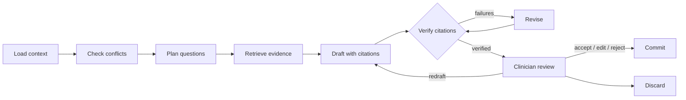

# Provenance Care Note

**English** | [简体中文](README.zh-CN.md)

[](https://github.com/hengbolei/provenance-care-note/actions/workflows/ci.yml) [](LICENSE)

A provenance-first care record with a **Clinical Review Agent**. Every claim the agent drafts
cites an exact span of the record and passes deterministic verification. Nothing reaches the
record until a clinician accepts it.

> Synthetic demonstration data only. This is a research prototype, not a medical device, and not
> ready for clinical use.

## How a review works



1. **Deterministic first.** Medication, dose and allergy conflicts are found by code and must be
   mentioned in the draft. The model cannot dismiss them or set risk levels.
2. **Plan and retrieve.** Standing questions, one per conflict and a few from the model are
   searched across the whole record (BM25 with brand/generic and spelling synonyms). Older
   evidence therefore reaches the draft even on long timelines.
3. **Cite and verify.** Each claim must quote the record. Code checks that the entry exists, the
   span is in bounds, the quote matches, the medication, dose and allergy facts agree with the
   source, and patient-reported text is phrased as reported. Failures go back to the model with
   the reasons, at most twice; anything still unsupported is shown as such.
4. **Clinician decides.** The run pauses. A clinician accepts, edits or rejects each claim and
   highlight. Commit writes an internal `agent_review` section revision as that clinician; the
   agent itself cannot write.

## Highlights

**Agent safety and privacy**

- Everything sent to a model is PHI-redacted first, and the request type refuses unredacted text.
  Offset maps let citations in redacted text resolve back to the original.
- Record text is framed as data and cannot forge framing tags. Instruction-like entries ("ignore
  previous instructions", "SYSTEM: …") are flagged, and suggestions that repeat them are withheld.
- Each run has budgets for steps, revisions, tokens, cost and time, and stops with a partial
  draft and a visible reason when one is reached.

**Operations**

- Runs are checkpointed in PostgreSQL with Fernet-encrypted state and clinic-scoped RLS, so they
  survive an app restart.
- Each run is one OpenTelemetry trace that carries IDs and counts only, never record text. The
  review panel shows a metadata-only run timeline.
- Model providers are OpenAI and Anthropic, with fallback to the other provider on errors. A
  recorded mode replays cassettes, so the demo, tests and CI need no API key.

**Evaluation**

- 36 synthetic cases across 8 families: medication changes, dose conflicts, new allergies,
  contradictory sources, sparse information, long timelines, prompt injection and PHI-heavy text.
- The **pipeline** suite needs no model and gates CI. It covers conflict recall, redaction and
  payload leaks, verifier accuracy, retrieval recall, key entries reaching the model, injection
  detection and framing.
- The **agent** suite scores real model drafts from cassettes and reports "not recorded" instead
  of inventing scores. Current results and known gaps are in the
  [evaluation report](evals/REPORT.md), which CI regenerates and checks.

**Care record**

- A 10-second Glance view with explainable priority factors, risk reasons and suggested actions.
- A longitudinal timeline of patient, staff, clinician and AI-scribed entries. Highlights and
  comments point to exact character spans and on to the original message or transcript.
- Highlight workflow with care-role assignment and open, in-progress and completed states. Care
  team comments support replies, mentions and resolve/reopen.
- Versioned sections and plans with history, any-version comparison, revert and optimistic
  concurrency checks.
- A patient-facing dashboard that shows only clinician-confirmed, published guidance and lets the
  patient add symptom updates or questions.
- An interface in English, Simplified Chinese and Traditional Chinese.

**Security baseline**

- Clinic scope, role ownership and patient self-access are enforced on the server.
- Signed, expiring HttpOnly sessions.
- Optional encrypted PostgreSQL snapshots with forced row-level security, plus encrypted cold
  archives.
- Hash-chained audit events and metadata-only request logs.

## Quick start

### Docker demo (no API key)

```bash
docker compose up --build
```

Open `http://127.0.0.1:8000`, sign in as `clinician` / `clinician-demo-2026` and click
**Prepare review**. The agent replays the recorded seed draft from `evals/cassettes/`. That draft
is hand-written to show the workflow and is labelled as such in the panel; it is never presented
as model output.

### Local development

```powershell
python -m venv .venv
.\.venv\Scripts\python.exe -m pip install -e ".[dev]"
.\.venv\Scripts\python.exe -m uvicorn carenote.main:app --reload
```

- Application: `http://127.0.0.1:8000`
- API documentation: `http://127.0.0.1:8000/docs`

Development uses an in-memory repository. Setting `CARENOTE_DATABASE_URL` selects encrypted
PostgreSQL. The demo accounts are `patient`, `staff`, `clinician` and `admin`, with passwords
`<username>-demo-2026`. They are development-only and synthetic.

### Live models

`CARENOTE_AGENT_GATEWAY` selects how the agent calls a model:

| Value | Behaviour |
| --- | --- |
| `recorded` (default) | Replays cassettes; no key, no network |
| `openai` / `anthropic` | Live calls; needs `OPENAI_API_KEY` or `ANTHROPIC_API_KEY` |
| `live` | Live calls to `CARENOTE_AGENT_PROVIDER` |
| `record` | Live calls that also record cassettes |

`CARENOTE_AGENT_FALLBACK` names a second provider to try when the first one fails. Models,
fallback rules and recording are covered in [Development](docs/DEVELOPMENT.md#clinical-review-agent).
Run `python evals/run_evals.py --record` to record live drafts and score the agent suite.

## Verification

```powershell
.\.venv\Scripts\python.exe -m pytest -q                 # unit, API, agent and eval tests
.\.venv\Scripts\ruff.exe check .
.\.venv\Scripts\python.exe evals/run_evals.py --check   # evaluation gate
```

CI runs these on Python 3.11 and 3.12. It also runs PostgreSQL integration tests against a real
database, and a Docker job that signs in, runs a review, restarts the app, resumes the run and
commits it.

## Project layout

```text
src/carenote/
├── agent/         Review graph, tools, verifier, model gateways, prompts, tracing, persistence
├── retrieval/     BM25 retrieval and the synonym table
├── evals/         Evaluation case format, suites and report
├── api/           HTTP routes
├── services/      Use cases, policy enforcement, conflict detection, entity extraction
├── repositories/  In-memory and encrypted PostgreSQL adapters
├── privacy/       PHI redaction boundary
├── domain/        Domain models and API contracts
├── data/          Deterministic synthetic seed data
├── core/          Configuration, identity, security
└── static/        Web interface (vanilla JS, three languages)
evals/             Cases (YAML), cassettes and the generated report
migrations/        PostgreSQL schema and row-level security
scripts/           Demo cassette recording, Docker smoke test, Glance benchmark
tests/             Automated tests
docs/              Design, roadmap, architecture and operations
```

## Status and limitations

- **No live model has been evaluated yet.** The OpenAI and Anthropic adapters are tested with
  mocked HTTP only, so model metrics such as critical-finding recall and injection resistance
  appear once live cassettes are recorded.
- **Scale.** Each clinic's data is one encrypted snapshot loaded into memory, which suits a small
  deployment. Per-row storage is a planned separate refactor.
- **Known gaps** are listed in the [evaluation report](evals/REPORT.md) instead of being worded
  around. Examples: brand and generic names are not linked in conflict detection, partial names
  and email addresses are not redacted, and multi-word lay terms are not searched.
- Production use would need an organisational identity provider, managed keys, validated
  PostgreSQL RLS, and privacy and clinical approval. See
  [Production security](docs/PRODUCTION_SECURITY.md).

## Documentation

- [Clinical Review Agent design](docs/AGENT_DESIGN.md): goals, graph, tools, verification and evaluation
- [Agent roadmap](docs/AGENT_ROADMAP.md): phases, progress and every design decision
- [Evaluation](evals/README.md) and [current report](evals/REPORT.md)
- [Architecture](docs/ARCHITECTURE.md): layers, trust boundaries and production direction
- [Technical brief](docs/TECHNICAL_BRIEF.md): product thesis and scope
- [Development](docs/DEVELOPMENT.md): setup, configuration, tests and operation
- [Production security](docs/PRODUCTION_SECURITY.md): required configuration and secrets
- [Performance](docs/PERFORMANCE.md): Glance warm-path measurements
- [Attribution](ATTRIBUTION.txt): third-party licences

## License

MIT. See [LICENSE](LICENSE).
