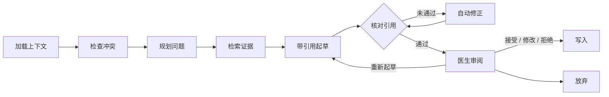

# Provenance Care Note

[English](README.md) | **简体中文**

[](https://github.com/hengbolei/provenance-care-note/actions/workflows/ci.yml) [](LICENSE)

一个以溯源为核心的护理记录系统，内置**临床审阅 Agent**。Agent 起草的每一句话都引用病历中的精确原文片段，并通过确定性校验；只有临床医生确认后，内容才会写入记录。

> 本仓库只包含合成的演示数据。这是研究原型，不是医疗器械，也不能用于临床。

## 一次审阅如何进行



1. **确定性优先。** 药物、剂量和过敏冲突由代码检出，草稿必须提到它们。模型不能忽略冲突，也不能决定风险等级。
2. **规划与检索。** 几个固定问题、每个冲突各一个问题，再加上模型补充的几个问题，都会在整份病历里检索，同时也在诊所的参考资料库（规范、指南、药品说明书）里检索。检索用 BM25，并配有商品名、通用名和拼写变体的同义词表。所以即使时间线很长，较早的证据也能进入草稿。
3. **引用与核对。** 每句话都必须引用原文。代码会检查：记录是否存在，位置是否越界，引文是否和原文一致，药物、剂量和过敏信息是否和原文相符，以及患者自述的内容是否用了转述措辞。没通过的内容连同原因交回模型修正，最多两轮；仍不成立的标为"未获支持"。参考资料从不支撑关于病人的陈述，只会作为单独的**需要核对的要点**出现：每条必须原样引用一个参考版本、写成核对的口吻，不能给出治疗或用药建议。
4. **医生决定。** 运行会暂停，由临床医生对每条陈述和每个重点事项选择接受、修改或拒绝。写入时以该医生的身份生成一个内部 `agent_review` 分区的新修订；Agent 本身没有写权限。

## 亮点

**Agent 的安全与隐私**

- 发给模型的内容一律先做 PHI 脱敏，请求类型本身就拒绝未脱敏的文本。位置映射让脱敏文本里的引用能对回原文。
- 病历文本作为数据框起来，无法伪造结构标签。针对助手的指令性文字（如"ignore previous instructions"、"SYSTEM: …"）会被标出，复述它们的建议会被拦下。
- 每次运行都有步数、修订次数、token、费用和时间上限。触顶时运行停止，保留已完成的部分草稿，并显示停止原因。

**运维**

- 运行状态保存在 PostgreSQL 中，状态用 Fernet 加密，并按诊所做行级隔离，所以应用重启后可以接着跑。
- 每次运行对应一条 OpenTelemetry 追踪，只包含 ID 和计数，不含病历文本。审阅面板会显示一条只含元数据的运行时间线。
- 模型提供方支持 OpenAI、Anthropic，以及任何兼容 OpenAI 接口的服务（DeepSeek、通义千问、Kimi、智谱 GLM、OpenRouter，或本地的 Ollama、vLLM），出错时可以回退到另一家。回放模式会重放录制的结果，所以演示、测试和 CI 都不需要 API key。

**评测**

- 39 个合成用例，分 9 类：用药变化、剂量冲突、新过敏、来源矛盾、信息稀少、长时间线、提示注入、标识符密集的文本和参考知识库。
- **pipeline** 评测不需要模型，作为 CI 门槛。它覆盖冲突检出、脱敏和模型输入中的标识符泄露、校验结论正确率、检索召回、关键记录是否送达模型、注入识别和标签完整性，以及参考文档检索（只检索当前生效的版本）和核对要点的校验结论。
- **agent** 评测用录制的真实模型草稿打分；没有录制时如实显示"未录制"，不编造分数。最新结果和已知缺口见[评测报告](evals/REPORT.md)，CI 会重新生成并核对这份报告。

**护理记录**

- 10 秒速览（Glance）视图，带可解释的优先级因子、风险原因和建议操作。
- 纵向时间线，包含患者、护理人员、临床医生和 AI 记录的条目。重点事项和评论都指向精确的字符区间，并能继续追溯到原始的消息或转录片段。
- 重点事项工作流：按护理角色分派，有待处理、进行中、已完成三种状态。护理团队评论支持回复、提及和解决或重新打开。
- 分区和诊疗计划都有版本管理：修订历史、任意版本对比、回滚和乐观并发检查。
- 参考资料库：诊所规范、临床指南和药品说明书，版本不可修改，由诊所管理员维护，护理团队可查阅。
- 患者端仪表盘只显示经临床医生确认并发布的指导，患者可以补充症状或提问。
- 界面支持英文、简体中文和繁体中文。

**安全基线**

- 诊所范围、角色归属和患者本人访问的检查都在服务端执行。
- 会话带签名、会过期，使用 HttpOnly Cookie。
- 可选的加密 PostgreSQL 快照，强制启用行级安全，另有加密的冷数据归档。
- 审计事件按哈希链串联，请求日志只记录元数据。

## 快速开始

### Docker 演示（不需要 API key）

```bash
docker compose up --build
```

打开 `http://127.0.0.1:8000`，用 `clinician` / `clinician-demo-2026` 登录，点 **生成审阅**（英文界面里是 **Prepare review**）。Agent 会回放 `evals/cassettes/` 里录制好的种子草稿。这份草稿是为演示流程手写的，面板上会如实标注，不会冒充模型输出。

### 本地开发

```powershell
python -m venv .venv
.\.venv\Scripts\python.exe -m pip install -e ".[dev]"
.\.venv\Scripts\python.exe -m uvicorn carenote.main:app --reload
```

- 应用：`http://127.0.0.1:8000`
- API 文档：`http://127.0.0.1:8000/docs`

开发环境默认使用内存存储；设置 `CARENOTE_DATABASE_URL` 后改用加密 PostgreSQL。演示账户有 `patient`、`staff`、`clinician` 和 `admin`，密码格式是 `<用户名>-demo-2026`。这些账户只用于开发环境，数据均为合成数据。

### 使用真实模型

`CARENOTE_AGENT_GATEWAY` 决定 Agent 如何调用模型：

| 取值 | 行为 |
| --- | --- |
| `recorded`（默认） | 回放录制结果，不需要 key，不联网 |
| `openai` / `anthropic` | 实时调用；需要 `OPENAI_API_KEY` 或 `ANTHROPIC_API_KEY` |
| `compatible` | 实时调用 `CARENOTE_COMPAT_BASE_URL` 上的兼容服务，模型由 `CARENOTE_COMPAT_MODEL` 指定；本地服务不需要 key |
| `live` | 实时调用 `CARENOTE_AGENT_PROVIDER` 指定的提供方 |
| `record` | 实时调用的同时录制结果 |

`CARENOTE_AGENT_FALLBACK` 指定第一家提供方出错时改用的另一家。模型、回退规则和录制方法见[开发文档](docs/DEVELOPMENT.md#clinical-review-agent)。运行 `python evals/run_evals.py --record` 可以录制真实草稿，并为 agent 评测打分。

## 验证

```powershell
.\.venv\Scripts\python.exe -m pytest -q                 # 单元、API、Agent 和评测测试
.\.venv\Scripts\ruff.exe check .
.\.venv\Scripts\python.exe evals/run_evals.py --check   # 评测门槛
```

CI 在 Python 3.11 和 3.12 上运行以上检查，另外还会对真实数据库跑 PostgreSQL 集成测试，并跑一个 Docker 任务：登录、发起审阅、重启应用、恢复运行，然后写入。

## 项目结构

```text
src/carenote/
├── agent/         审阅流程图、工具、校验器、模型网关、提示词、追踪、持久化
├── retrieval/     BM25 检索与同义词表
├── evals/         评测用例格式、评测套件与报告
├── api/           HTTP 路由
├── services/      用例、权限策略、冲突检测、实体抽取
├── repositories/  内存与加密 PostgreSQL 存储适配器
├── privacy/       PHI 脱敏边界
├── domain/        领域模型与 API 契约
├── data/          确定性合成种子数据
├── core/          配置、身份、安全
└── static/        Web 界面（原生 JS，三种语言）
evals/             评测用例（YAML）、录制结果与生成的报告
migrations/        PostgreSQL 表结构与行级安全
scripts/           演示录制、Docker 冒烟测试、Glance 基准测试
tests/             自动化测试
docs/              设计、路线图、架构与运维文档
```

## 现状与局限

- **还没有用真实模型做过评测。** OpenAI、Anthropic 和兼容接口适配器只用模拟的 HTTP 测试过。关键发现召回率、注入抵抗等模型指标，要等录制真实结果后才会出现。
- **规模。** 每个诊所的数据是一份加密快照，整体加载进内存，适合小规模部署。按行存储计划作为单独的重构来做。
- **已知缺口**直接列在[评测报告](evals/REPORT.md)里，没有回避。例如：冲突检测还没把商品名和通用名关联起来；部分姓名和邮箱不会被脱敏；多词的通俗说法检索不到。
- 投入生产还需要机构的身份认证系统、托管密钥、在目标数据库上验证过的行级安全，以及隐私和临床审批。详见[生产安全](docs/PRODUCTION_SECURITY.md)。

## 文档

- [临床审阅 Agent 设计](docs/AGENT_DESIGN.md)：目标、流程图、工具、校验与评测
- [Agent 路线图](docs/AGENT_ROADMAP.md)：各阶段、进度和所有设计决策
- [评测说明](evals/README.md)与[最新报告](evals/REPORT.md)
- [架构](docs/ARCHITECTURE.md)：分层、信任边界和生产方向
- [技术简介](docs/TECHNICAL_BRIEF.md)：产品思路与范围
- [开发](docs/DEVELOPMENT.md)：环境、配置、测试与运行
- [生产安全](docs/PRODUCTION_SECURITY.md)：必需配置与密钥管理
- [性能](docs/PERFORMANCE.md)：Glance 热路径测量
- [第三方许可](ATTRIBUTION.txt)

## 许可证

MIT，见 [LICENSE](LICENSE)。
