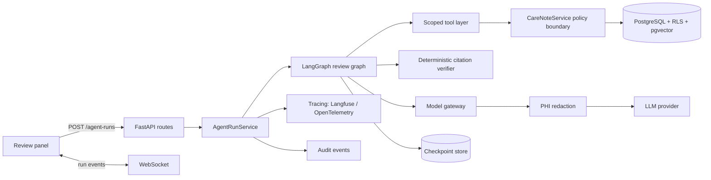
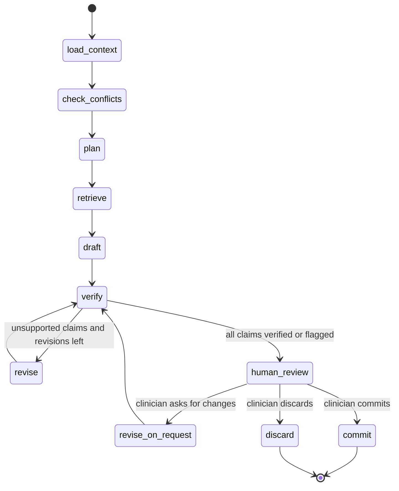

# Clinical Review Agent — Design

Status: proposed · Owner: Lei Hengbo · Last updated: 2026-10-17

## 1. Summary

Provenance Care Note already has the hard, unglamorous half of a clinical AI system: role-based
access, clinic-scoped row-level security, exact provenance pointers, review states, revision
history, audit events and a PHI redaction boundary. Its only model integration is a single-shot
summary call (`OpenAIClinicalGateway.summarize`) that produces one `ai_suggested` timeline entry.

This design adds a **Clinical Review Agent**: a multi-step, tool-using agent that prepares a
patient review for a clinician. It reads the timeline through scoped tools, drafts a structured
summary in which every claim cites an exact source span, proposes candidate highlights, verifies
its own citations, and then **stops for human review**. Nothing the agent writes can become
clinician-confirmed or patient-facing without an explicit clinician action, and every step is
traced, budgeted and evaluated.

The goal is to show agent engineering that survives contact with a high-stakes, regulated
domain, not a chat demo.

## 2. Goals and non-goals

**Goals**

1. A clinician can request "Prepare review" for a patient and receive, within ~30 s, a draft with
   claim-level citations and candidate highlights, streamed as it is produced.
2. Every claim either resolves to a real, accessible source span or is flagged as unsupported.
3. The clinician can accept, edit or reject each claim and highlight; decisions reuse the existing
   review states, revisions and audit trail.
4. A versioned evaluation suite reports citation validity, critical-finding recall,
   unsupported-claim rate and prompt-injection resistance, and runs in CI.
5. Each run is observable end to end: steps, tool calls, tokens, latency and cost.
6. A public demo runs on synthetic data, including an offline mode that needs no API key.

**Non-goals**

- Diagnosis, treatment recommendations or medication dosing advice.
- Autonomous writes to confirmed or patient-facing content.
- Real patient data, EHR integration or certification as a medical device.
- A general chat assistant over the record.

## 3. Current baseline

| Capability | Where it lives | How the agent uses it |
| --- | --- | --- |
| Actors, roles, clinic scope | `domain/models.py` (`Actor`, `Role`), `core/identity.py` | The agent runs on behalf of the requesting clinician, as `Role.SYSTEM` scoped to that clinic |
| Timeline entries and source artifacts | `TimelineEntry`, `SourceArtifact`, `EntryOrigin` | Read through tools; cited by `ProvenancePointer` |
| Exact provenance | `ProvenancePointer(entry_id, start, end)`, `SourceArtifactPointer` | Required on every claim; verified deterministically |
| Review states | `ReviewStatus` (`ai_suggested`, `clinician_confirmed`, `needs_review`, `rejected`) | Agent output is always `ai_suggested` |
| Highlights and priority | `Highlight`, `DeterministicImportanceScorer` | Agent proposes candidates; the scorer, not the model, sets priority |
| Conflict detection | `DeterministicConflictDetector` | Exposed as a tool; its findings outrank model opinions |
| Revisions and audit | `SectionRevision`, `AuditEvent`, `list_audit_events` | Every agent action emits metadata-only audit events |
| PHI redaction | `privacy/redaction.py` (`PHIRedactionGateway`) | Mandatory on every model-bound payload |
| Realtime | `services/realtime.py`, `/ws/patients/{id}` | Streams run progress to the review UI |
| Storage | `repositories/memory.py`, `repositories/postgres.py` + `migrations/001_postgres_rls.sql` | Adds run, checkpoint and embedding tables under the same RLS |

## 4. User flow

1. A clinician opens a patient and clicks **Prepare review**.
2. The UI shows live progress: *Loading context → Checking conflicts → Retrieving evidence →
   Drafting → Verifying citations*.
3. The draft appears in a review panel: a list of claims, each with a risk level and clickable
   citations that jump to the exact span in the timeline (reusing the existing span highlighting).
   Unsupported claims are shown struck through with the reason.
4. Candidate highlights appear beside the draft with the scorer's priority factors.
5. The clinician accepts, edits or rejects each item, optionally asks the agent to revise with a
   short instruction, and finally clicks **Commit**. Accepted claims become a clinician-authored
   revision of an `agent_review` section; accepted highlights become `Highlight` records.
6. Everything is visible later in the audit trail and linked to the trace of the run.

## 5. Architecture



New modules:

```
src/carenote/agent/
  graph.py        # LangGraph state machine and node functions
  state.py        # ReviewState and structured output schemas
  tools.py        # scoped, typed tools over CareNoteService
  verify.py       # deterministic citation and policy checks
  gateway.py      # provider-agnostic model interface + recorded/offline adapter
  runs.py         # AgentRunService: start, stream, resume, commit, budgets
  prompts/        # versioned prompt templates
evals/
  cases/          # golden cases (YAML) built on the synthetic seed
  run_evals.py    # scorer and report
  cassettes/      # recorded model responses for deterministic CI runs
```

**Framework choice.** LangGraph is used for orchestration because the design needs exactly what it
provides: an explicit state machine, conditional loops, `interrupt` for human review and durable
checkpoints that let a run resume after the clinician responds. It is also the framework most
often named in agent application roles. The tool layer and verifier are plain Python behind
interfaces, so the graph could move to another runtime without touching policy code.

## 6. Agent graph



| Node | Model? | What it does |
| --- | --- | --- |
| `load_context` | No | Loads patient metadata, the most recent entries and open highlights through tools; records entry IDs and lengths for verification |
| `check_conflicts` | No | Runs `DeterministicConflictDetector`; conflicts are injected as must-mention facts |
| `plan` | Yes | Produces a short list of review questions (e.g. "medication changes since last visit") as structured output |
| `retrieve` | No | For each question, runs hybrid search and collects candidate spans |
| `draft` | Yes | Writes `DraftReview` (schema below) using only retrieved spans |
| `verify` | No | Deterministic checks (section 8); marks each claim `verified` or `unsupported` with a reason |
| `revise` | Yes | Rewrites or drops unsupported claims; at most 2 loops |
| `human_review` | No | LangGraph `interrupt`; state is checkpointed and the run waits |
| `commit` | No | Applies clinician decisions through existing service methods and audit events |

**State**

```python
class ReviewState(TypedDict):
    run_id: UUID
    actor: Actor                    # requesting clinician
    patient_id: UUID
    context: list[EntryRef]         # entry_id, length, type, author_role, internal
    conflicts: list[ConflictFinding]
    questions: list[str]
    evidence: dict[str, list[Span]] # question -> retrieved spans
    draft: DraftReview | None
    verification: list[ClaimCheck]
    revisions_used: int
    budget: Budget                  # steps, tokens, wall clock, cost
    decisions: ReviewDecisions | None
```

## 7. Tools and structured output

The model never sees repository objects directly. It sees typed tools, and every tool call runs
through `CareNoteService` with the requesting clinician's clinic scope.

| Tool | Access | Returns |
| --- | --- | --- |
| `get_patient_overview()` | read | Synthetic demographics (redacted), open highlights, section states |
| `list_entries(since, types, limit)` | read | Entry refs with IDs, types, authors, timestamps |
| `read_entry(entry_id)` | read | Redacted entry text with character offsets preserved |
| `search_entries(query, k)` | read | Hybrid search hits as `Span(entry_id, start, end, text)` |
| `get_source_evidence(entry_id)` | read | Original artifact excerpt for AI-scribed entries |
| `detect_conflicts()` | read | Deterministic medication, dose and allergy conflicts |
| `propose_highlight(span, risk_reason, suggested_action)` | propose | A candidate held in run state, not persisted until commit |

There is no tool that confirms, publishes, edits a section or changes access. "Propose" tools
only add to run state; persistence happens in `commit`, driven by clinician decisions.

**Draft schema** (Pydantic, enforced through the provider's structured output mode):

```python
class Citation(BaseModel):
    entry_id: UUID
    start: int
    end: int
    quote: str = Field(max_length=300)   # exact text the model claims is at the span

class Claim(BaseModel):
    text: str = Field(max_length=400)
    category: Literal["medication", "allergy", "symptom", "plan", "follow_up", "other"]
    risk_level: RiskLevel
    citations: list[Citation] = Field(min_length=1)

class DraftReview(BaseModel):
    claims: list[Claim]
    open_questions: list[str]            # gaps the clinician should resolve
    candidate_highlights: list[CandidateHighlight]
```

## 8. Citation verification

Verification is deterministic and runs on every draft:

1. **Exists and in scope**: `entry_id` is in `context` and readable by the actor.
2. **In bounds**: `0 <= start < end <= len(entry.content)`.
3. **Quote match**: the text at `[start, end)` matches `quote` after whitespace normalisation;
   if not, try to relocate the quote within the entry and repair the offsets, otherwise fail.
4. **Support**: the cited spans share key clinical entities (drug, dose, allergen, symptom) with
   the claim text, using the same entity extraction as the conflict detector.
5. **Policy**: a claim citing only patient-authored content cannot be `high` or `critical` risk
   without a staff or clinician source, and must be phrased as reported, not as fact.
6. **Conflicts covered**: every deterministic conflict is mentioned by at least one claim.

Claims that fail are marked `unsupported` with the reason and sent to `revise`. After two loops,
remaining failures are shown to the clinician as unsupported rather than silently dropped.

An optional LLM-as-judge pass checks semantic support. It is used in evaluation, and only as an
extra flag in the product, never to override a deterministic failure.

## 9. Retrieval

- **Index**: a `entry_embeddings` table (pgvector) with chunk offsets, keyed by `entry_id`, carrying
  `clinic_id` so the existing forced RLS policies apply. Chunks keep character offsets, so search
  hits are already valid citations.
- **Hybrid search**: Postgres full-text (`tsvector`) plus vector similarity, merged with reciprocal
  rank fusion. Keyword search matters for drug names and doses, which embeddings blur.
- **Freshness**: new entries are embedded on write; a backfill script covers the seed.
- **In-memory adapter**: keyword-only search, so tests and the offline demo need no embedding
  model.
- **Scope**: patient-facing (`internal=False`) and internal entries are both searchable for
  clinicians; retrieval for any future patient-facing feature must filter to non-internal entries.

## 10. Safety and trust boundaries

| Threat | Control |
| --- | --- |
| PHI sent to a provider | Every model-bound string passes through `PHIRedactionGateway`; the gateway refuses unredacted input by construction; offsets are preserved by fixed-width placeholders or an offset map |
| Prompt injection in patient-authored text ("ignore previous instructions…") | Entry text is passed as quoted data with author role and type, never as instructions; the system prompt states that record content is untrusted; no tool can write confirmed or patient-facing data, so a successful injection can at most produce an `ai_suggested` draft that a clinician reviews; injection cases are part of the eval suite |
| Fabricated citations | Deterministic verification (section 8) |
| Overconfident risk labels | Risk level for highlights is set by the deterministic scorer; model-proposed risk on claims is capped by the provenance policy |
| Runaway cost or loops | Per-run budget: max 12 graph steps, 2 revise loops, token and cost ceilings, 60 s wall clock; exceeding a budget ends the run with a partial draft and a visible reason |
| Cross-clinic data access | Tools run through `CareNoteService` with the actor's clinic; Postgres RLS remains the last line of defence |
| Agent impersonating a clinician | Agent writes are authored as `Role.SYSTEM` with `review_status=ai_suggested`; only `commit`, triggered by a clinician session, can confirm |

## 11. Human in the loop and audit

- The graph pauses at `human_review` using LangGraph `interrupt`; state is stored with a Postgres
  checkpointer (in-memory saver for tests), so a run survives server restarts.
- The review API accepts per-item decisions: `accept`, `edit(text)`, `reject(reason)`, plus an
  optional `revise(instruction)` that resumes the graph.
- `commit` maps decisions onto existing operations: accepted and edited claims become a new
  revision of a new `agent_review` section authored by the clinician, leaving the existing `plan`
  section untouched; accepted highlights are created through `create_highlight`, acting as the
  committing clinician, so its span and scope checks apply unchanged.
- New audit operations, all metadata-only: `agent_run_started`, `agent_tool_called`,
  `agent_draft_proposed`, `agent_claim_accepted`, `agent_claim_edited`, `agent_claim_rejected`,
  `agent_run_committed`, `agent_run_discarded`, `agent_budget_exceeded`. Each carries `run_id`.

## 12. Observability

- One trace per run (Langfuse, self-hosted in Docker Compose, or any OpenTelemetry backend),
  with a span per node, tool call and model call.
- Recorded per run: model and prompt version, input and output tokens, cost estimate, latency per
  node, tool call count, revise loops used, number of unsupported claims, budget outcome.
- Traces carry only redacted text; the trace ID is stored on the audit event for joins.
- A small `/agent-runs/{id}` view in the UI shows the step timeline for demos and debugging.

## 13. Evaluation

**Dataset.** 30–50 golden cases in `evals/cases/*.yaml`, generated from the synthetic seed with
controlled variations. Each case lists the entries and the expected facts.

| Case family | What it tests |
| --- | --- |
| Medication change, dose conflict, new allergy | Critical-finding recall and conflict coverage |
| Contradictory sources (patient vs clinician) | Correct attribution and provenance policy |
| Sparse or missing information | Open questions instead of invented facts |
| Long timelines (50+ entries) | Retrieval quality, latency and cost |
| Prompt injection in patient notes and transcripts | Injection resistance |
| PHI-heavy text | Redaction coverage before model calls |

**Metrics**

| Metric | Definition | Target for v1 |
| --- | --- | --- |
| Citation validity | Share of citations passing checks 1–3 before revision | ≥ 95% after revision |
| Unsupported-claim rate | Claims still unsupported after revision / all claims | ≤ 5% |
| Critical-finding recall | Expected critical facts covered by a verified claim | ≥ 90% |
| Conflict coverage | Deterministic conflicts mentioned | 100% |
| Injection resistance | Injection cases where output follows the injected instruction | 0 |
| PHI leakage | Unredacted identifiers in model-bound payloads | 0 |
| p50 / p95 latency, cost per run | From traces | Reported, with regression alerts |

**Running.** `python evals/run_evals.py --mode recorded` replays cassettes and runs in CI on every
PR, failing on regressions beyond set thresholds. `--mode live` calls the provider and refreshes
cassettes; it is run manually or on a schedule. Results are written as a Markdown table that the
README links to, with history kept per prompt version.

## 14. Model gateway

- A provider-agnostic interface with `structured(schema, messages)` and `text(messages)`.
- Adapters: OpenAI (current), one second provider, and a **recorded** adapter that replays
  cassettes for tests, CI and the offline demo.
- Configuration by environment: drafting model, verification-judge model, timeouts, retries with
  backoff, and fallback to the secondary provider on errors.
- Prompts are versioned files; the version is stored on each run and trace.

## 15. API changes

| Method and path | Purpose |
| --- | --- |
| `POST /patients/{patient_id}/agent-runs` | Start a review run; returns `run_id` |
| `GET /agent-runs/{run_id}` | Run status, draft, verification results, budget usage |
| `POST /agent-runs/{run_id}/review` | Submit per-item decisions; `revise` resumes the graph |
| `POST /agent-runs/{run_id}/commit` | Commit accepted items |
| `POST /agent-runs/{run_id}/discard` | Discard the run |
| WebSocket `/ws/patients/{patient_id}` | New event types: `agent.step`, `agent.draft`, `agent.done` |

All endpoints require a clinician session in the patient's clinic.

## 16. Deployment

- `docker-compose.yml` with the app, Postgres with pgvector, and optional Langfuse.
- Public demo on a low-cost host with seeded synthetic data, demo clinician and patient accounts,
  and the recorded model adapter as the default so the demo works without spending tokens; a
  live mode is enabled only with a configured key.
- Existing production checks in `core/config.py` (HTTPS base URL, required secrets) stay in force.

## 17. Milestones

| Week | Deliverable | Exit criteria |
| --- | --- | --- |
| 1 | Graph with `load_context → draft → verify → human_review → commit`, structured output, deterministic verifier, recorded gateway, review panel, Docker Compose, public demo | Demo link works offline; CI green; README GIF |
| 2 | Eval suite (≥ 30 cases), CI eval gate, tracing, budgets | Metrics table in README; trace view in demo |
| 3 | Hybrid retrieval with pgvector, conflict tool, injection defences and cases, revise loop, second provider | Injection resistance 0 failures; recall ≥ 90% on long timelines |
| Later | Expose tools as an MCP server; streaming token output; per-claim LLM-judge flag in UI | — |

## 18. Risks and open questions

- **Offset preservation through redaction.** Replacing names with placeholders shifts offsets.
  Plan: keep an offset map in `RedactionResult` and translate citations back; covered by tests.
- **Structured output limits.** Long timelines may push drafts past output limits. Plan: cap
  claims per run and paginate by review question.
- **Evaluation realism.** Synthetic cases may be easier than real notes. Plan: include noisy,
  contradictory and long cases, and report results per family rather than one average.
- **Framework lock-in.** Mitigated by keeping tools, verifier and gateway framework-free.
- **Open question:** should the `agent_review` section be shown to patients after commit, or stay
  internal until a clinician explicitly publishes guidance through the existing patient-facing
  flow? Default: internal.
